# CatWeb-styled New Tab v1.1.0
A vibecoded **CatWeb-styled** new-tab extension supporting **most browsers**

## How to use it
1. Download the source code as a ZIP
2. In your file browser, unzip the file you just downloaded
3. Open your browser and head to browser://extensions (replace browser with the name of your browser)
4. Turn on developer mode if not already on
5. Click "Load Unpacked"
6. Select the folder you downloaded, then click Open Folder at the bottom-right of your file browser (might be different on MacOS or other OSes)
7. Done! Your new-tab now uses the CatWeb-NewTab!

## Current features
1. **Supports CatWeb sites** - you can search e.g. z4.rbx and it will redirect to https://catweb.dev/z4.rbx.
2. **Add Shortcuts** - Add shortcuts to the new-tab to easily access your favourite sites. This also supports CatWeb sites, but you need to select it.
3. **Any search engine** - It uses your default search engine, no need to change it in its own settings.
4. **Custom themes** - You can add themes, there is preset colors and custom color picker.

## Upcoming features
**Save after update** - themes & shortcuts will be saved after downloading a new update.

# Request features and feedback [here](https://discord.com/channels/1226224104370208860/1573790068974555368)
